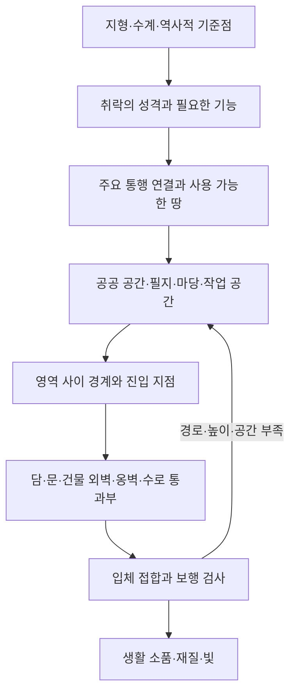
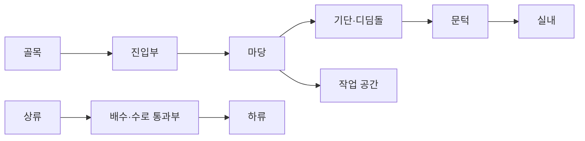

# 도시·마을 빌더의 경계 설계 제안

2026-10-24 / 제안 단계 / 게임 코드 반영 없음.
근거: [2차 사례 분석](evidence-pass2.md). 아래 데이터 구성과 검증 방식은 사례에서 도출한 소프트웨어 설계 제안이며, 조선시대 도시의 보편적 법칙이 아니다.

## 핵심 결정

건물마다 직사각형 담을 붙이는 방식으로 도시 전체의 경계를 해결하지 않는다. 먼저 영역·접근·수계·높이 관계를 정하고 경계가 필요한 곳에서 담·건물 외벽·옹벽·열린 경계를 선택한다.

이는 일회성 순서가 아니다. 집 묶음이 필지에 들어가지 않으면 앞 단계로 되돌아가야 한다. 건물을 억지로 축소하거나 출입구를 없애며 수량을 맞추지 않는다.

## 1. 경계선 하나에 필요한 의미

| 정보 | 필요한 이유 |
|---|---|
| 양쪽 공간 ID | 도로와 주택 사이인지, 두 필지 사이인지, 마당 내부 구분인지 알기 위해 |
| 경계의 목적 | 사생활·영역 표시·방풍·방어·토압 지지 등을 구분하기 위해 |
| 선형과 지면 높이 | 평면 곡선과 실제 높이 변화가 같은 결과를 만들지 않기 때문에 |
| 마감 방식 | 담, 건물 외벽, 옹벽, 식생, 열린 경계를 구분하기 위해 |
| 출입·배수·교차 구간 | 의도된 열린 부분과 생성 오류의 틈을 구분하기 위해 |
| 끝점의 연결 대상 | 다른 담, 문설주, 건물, 옹벽, 의도된 끝마감과 만나게 하기 위해 |
| 출처·적용 유형 | 특정 정원·고택의 특수 구조를 모든 집에 전파하지 않기 위해 |

경계선 하나가 언제나 벽체 하나라는 뜻은 아니다. 두 필지 사이에 각각의 담과 좁은 배수 공간이 필요한 경우도 표현할 수 있어야 한다. 다만 같은 실체를 양쪽 필지에서 중복 생성하지 않는다.

## 2. 의도된 열린 부분의 종류

| 종류 | 사람 통행 | 물 통과 | 반드시 확인할 사항 |
|---|---|---|---|
| 문·대문·협문 | 설정에 따름 | 자동으로 허용하지 않음 | 접근로, 문턱, 문 움직임과 통행 공간 |
| 지붕 없는 진입부 | 허용 | 지형에 따름 | 마당 연결, 끝마감, 임의 틈과 구분 |
| 담 아래 수구 | 보통 통행 경로로 쓰지 않음 | 허용 | 유입·유출, 지지 구조, 바닥 높이 |
| 물길 위 담 구조 | 별도 경로 필요 | 허용 | 지지대, 하상, 물길의 연속 |
| 열린 경계 | 공간 성격에 따름 | 지형에 따름 | 개방 이유와 영역 표시 방식 |
| 폐가의 파손부 | 상태에 따름 | 상태에 따름 | 의도된 파손과 생성 오류를 다른 상태로 저장 |

소쇄원 사례는 수구와 옛 협문을 구분해야 한다는 근거다. 사람과 물이 같은 구멍으로 지나간다고 단순화하지 않는다.

## 3. 직선·곡선·모서리

- 지형·기존 길·필지 경계가 직선이면 직선을 유지할 수 있다.
- 방향 변화의 근거가 있을 때 절선 또는 곡선을 선택한다. 모든 점에 무작위 흔들림을 주지 않는다.
- 모서리는 만나는 두 벽의 재료·두께·윗마감을 연결한다. 별색 기둥으로 결함을 가리지 않는다.
- 수평상으로 이어져도 높이 차가 있으면 접합을 따로 처리한다. 지면 추종, 계단형 높이 전환, 옹벽 위 담은 서로 다른 경우다.
- 처마 아래 담, 건물 외벽에 붙는 담, 대문 주변은 건물과 함께 검사한다. 중심선만 맞는 것은 통과 조건이 아니다.

## 4. 평면과 단면의 확인 항목

평면 관계 예시(실제 유산의 복원 도면이 아닌 게임 설계 관계도):

단면은 골목 바닥, 진입부 바닥, 마당, 기단, 실내 바닥을 따로 갖는다. 이 높이들의 연결을 계단·경사·디딤돌 등으로 해결하며, 캐릭터 발 위치와 충돌도 같은 높이를 사용해야 한다. 수로 바닥은 이 보행 단면과 별도다. 이 단계에서는 실제 치수를 임의로 정하지 않는다.

## 5. 구현 전에 고정할 검증 사례

| 시험 입력 | 통과해야 하는 결과 |
|---|---|
| 평지의 서로 이웃한 두 필지 | 경계 소유가 명확하며 같은 담이 중복되지 않음 |
| 곡선 골목 옆 필지 | 담은 경계를 따르고 접근로가 끊기지 않음 |
| 직선과 곡선의 접합 | 틈·돌출·급격한 두께 변화가 없음 |
| 세 경계가 만나는 곳 | 중복 기둥이나 통행을 막는 삼각 틈이 없음 |
| 두 필지 사이 좁은 배수 공간 | 필요한 이중 경계를 오류로 합치지 않음 |
| 경사진 마당의 진입부 | 기단·문턱에 도달할 수 있으며 발이 바닥 아래로 들어가지 않음 |
| 담 아래 개울 | 수계 연결과 지지 구조가 유지됨 |
| 건물 외벽에 닿는 담 | 외벽 관통·겹치는 면·이유 없는 틈이 없음 |
| 길가 작업장 | 작업 공간과 통행 공간이 함께 유지됨 |
| 의도된 열린 마당 | 빈 구간이 생성 실패와 구분됨 |
| 폐가 옵션 | 파손 위치가 기록되고 기본 건물의 정상 생성과 구분됨 |
| 다른 지형으로 동일 유형 재생성 | 개별 좌표 패치 없이 같은 관계 검증이 가능함 |

이 표는 시험 설계이며 실행 결과가 아니다. 실제 구현 시 평면·눈높이·보행 결과를 같은 사례 ID로 남긴다. 현재는 어떤 항목도 실행 통과로 표시하지 않는다.

## 6. 아직 결정하지 않는 것

고지도 대조 전의 주요 건물 좌표, 담장 높이·골목 폭·필지 밀도의 전국 공통 수치, 특정 마을의 보편화, 자연스러움 명목의 곡률 계수, 폐가의 붕괴 방식, 계곡 전체의 바위 피복률은 보류한다. 미확정 항목은 누락이 아니라 추가 근거가 필요한 입력이다.
